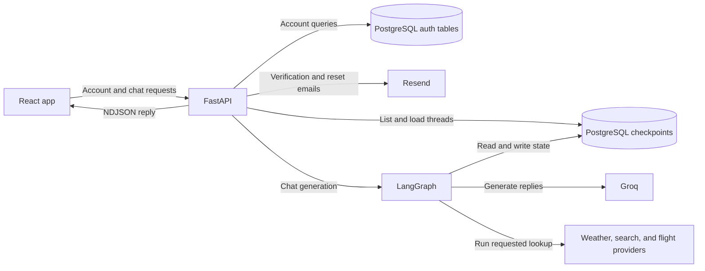

# MainChatbot backend project guide

[Setup and tests](../README.md) · [Changelog](../CHANGELOG.md) · [HTTP middleware](../MIDDLEWARE.md)

## Architecture

| Area | Source | Responsibility |
| --- | --- | --- |
| Application | [app/main.py](../app/main.py) | Mounts auth and chat routes, exposes health, and manages startup and shutdown |
| Accounts | [app/auth/](../app/auth/) | Validates requests, manages accounts and sessions, and sends verification and reset emails via Resend |
| Chat | [app/chat/](../app/chat/) | Reads and writes account-scoped threads, runs lookup tools, and streams replies from LangGraph |
| Database | [app/db/](../app/db/), [alembic/](../alembic/) | Defines database sessions and Alembic migrations for authentication tables |
| HTTP configuration | [app/core/](../app/core/) | Loads settings and defines cookies, middleware, and the system prompt |

At startup, the app initializes `AsyncPostgresSaver` and compiles the graph. Each chat turn combines the system prompt with saved messages and calls Groq's `openai/gpt-oss-120b` model. When the model requests a tool, LangGraph runs it and returns the result to the model. LangGraph checkpoints the conversation state so later turns can continue on the same thread.



## Chat tools

The tools run inside the existing chat workflow. Send requests through `POST /chat/chat-message` using the usual message body. The model decides when a lookup is needed. [Tool implementations](../app/chat/tools.py) · [Graph routing](../app/chat/service.py)

| Tool | Input | Provider and result |
| --- | --- | --- |
| `get_weather` | City name | Open-Meteo geocoding and current conditions, including temperature, humidity, wind, and precipitation |
| `search_web` | Search query | DuckDuckGo text search through `duckduckgo_search`, with up to five titles, snippets, and source URLs |
| `get_flight_delay_prediction` | IATA flight number such as `6E2017` | AviationStack status, departure timing, and delay in minutes when available. AviationWeather.gov METAR observations provide context for supported Indian departure airports. |

Flight delay explanations use status and weather heuristics. Get confirmed status and delay reasons from the airline. The AviationStack request currently sends the key in the query string over HTTP. Use an HTTPS endpoint before sending a production key.

## Databases and environment

| Setting | Used by |
| --- | --- |
| `DATABASE_URL` | FastAPI auth sessions through SQLAlchemy and asyncpg. Use a `postgresql+asyncpg://` URL. |
| `DIRECT_URL` | Alembic migrations through an async SQLAlchemy engine. Use a direct async URL such as `postgresql+asyncpg://`. |
| `CHECKPOINT_DATABASE_URL` | LangGraph checkpoint initialization and history reads. Use a psycopg-compatible `postgresql://` URL. |
| `SECRET_KEY`, `ALGORITHM` | JWT signing and verification |
| `ACCESS_TOKEN_EXPIRE_MINUTES`, `REFRESH_TOKEN_EXPIRE_DAYS` | Access and refresh session lifetimes |
| `GROQ_API_KEY` | Model access |
| `AVIATIONSTACK_KEY` | Required startup setting for AviationStack flight-status requests |
| `RESEND_API_KEY`, `FROM_EMAIL` | Transactional email delivery |
| `BACKEND_URL`, `FRONTEND_URL` | Public origins used when building email links. Set `FRONTEND_URL` for the React reset flow. |
| `CORS_ORIGINS` | JSON array of exact browser origins. The origin of `FRONTEND_URL` is added automatically. |

Alembic owns `users`, `email_verifications`, `refresh_tokens`, and `password_reset_tokens`. LangGraph creates its own checkpoint tables on application startup. The runtime auth connection must see the tables created by Alembic, and the checkpoint connection must have permission to initialize and use the checkpoint tables.

## HTTP API

Use [the local Swagger UI](http://127.0.0.1:8000/docs) for request validation and response schemas. The legacy browser redirect at `GET /auth/reset-password` is deliberately excluded from OpenAPI.

| Method and path | Request | Result |
| --- | --- | --- |
| `GET /health` | None | `{"status":"ok"}` after application startup |
| `POST /auth/user_registration` | JSON `name`, `email`, `password`, optional `website` | `201` with a registration acknowledgement. Leave the honeypot field `website` empty. |
| `GET /auth/verify-email` | `token` query parameter | Verifies the account's email |
| `POST /auth/user_login` | Form fields `username` (email) and `password` | Issues access and refresh cookies for a verified account |
| `POST /auth/refresh` | Refresh cookie | Rotates refresh credentials and issues fresh cookies |
| `GET /auth/me` | Authenticated request | Current account profile |
| `POST /auth/forgot-password` | JSON `email` | Account-neutral confirmation and a reset email when applicable |
| `GET /auth/reset-password` | `token` query parameter | `303` to the React reset page when configured |
| `POST /auth/reset-password` | Form fields `token` and `new_password` | Consumes the reset token, changes the password, and clears session cookies |
| `POST /auth/change-password` | Authenticated JSON `current_password` and `new_password` | Changes the password, revokes refresh sessions, and clears session cookies |
| `POST /auth/logout` | Authenticated request | Revokes the account's refresh sessions and clears cookies |
| `GET /chat/chats` | Authenticated request | Conversation summaries with `id`, `title`, and `user_id`, newest checkpoint first |
| `GET /chat/current-chat/{thread_id}` | Authenticated request with the client thread ID | Saved messages in conversation order, or an empty array when the thread has no messages |
| `POST /chat/chat-message` | Authenticated JSON `thread_id`, `messages`, and optional `title` | An NDJSON stream with incremental assistant output |

Access authentication accepts an `Authorization: Bearer` token or the `access_token` cookie. The browser uses HTTP-only cookies with `SameSite=Lax`. The access cookie uses `/` and the refresh cookie is scoped to `/auth`. For a matching account, a recovery request issues a new reset token and invalidates previous unused ones. The database stores a hash of the reset token.

### Chat thread lifecycle

1. The frontend generates a thread ID with the first submitted message. Use that same client ID for later messages and reads.
2. The backend prefixes the ID with the authenticated account ID when addressing a checkpoint. Clients send the unprefixed ID.
3. The stream emits one JSON object per line. It forwards nonempty message content, which can include intermediate tool results. A successful stream ends with `done`. A generation failure emits `error`, which the client must handle even if the HTTP response already started.
4. The history endpoint returns `human` and `ai` records. It omits empty assistant content and internal messages. The sidebar endpoint uses saved title metadata or the first human message as a fallback.

Example first message body

```json
{"thread_id":"65a7385d-59a7-4655-9185-5d2aef87ab8e","messages":"Summarize this idea.","title":"Summarize this idea."}
```

Example stream

```jsonl
{"type":"token","content":"Here is a short summary."}
{"type":"done"}
```

Example saved transcript

```json
[
  {"type":"human","content":"Summarize this idea."},
  {"type":"ai","content":"Here is a short summary."}
]
```

## Operations and troubleshooting

| Symptom | Check |
| --- | --- |
| Startup fails before `/health` is reachable | Check required settings, PostgreSQL connectivity, and checkpoint initialization permissions. |
| Sign-in or registration fails with a missing-table error | Apply `python -m alembic upgrade head` and confirm the runtime auth connection points to the migrated database. |
| Verification or reset email never arrives | Check Resend credentials, sender authorization, delivery logs, and `FRONTEND_URL`. Reset links expire after 15 minutes. |
| Chat lookup fails | Check outbound access to the relevant provider. For flight status, also check `AVIATIONSTACK_KEY` and provider access for the flight. |
| Browser API requests fail with a CORS error | Confirm the origin includes the correct scheme, host, and port. Review the [middleware configuration](../MIDDLEWARE.md). |
| The assistant reply arrives in one large block | Verify the reverse proxy forwards streaming response chunks without buffering. The chat API serves `application/x-ndjson`. |

For deployment, use HTTPS and set the cookie `secure` flags in [app/core/cookies.py](../app/core/cookies.py). The current code sets them to `False` for local HTTP. Keep the browser app and public API on one origin for the existing cookie flow and preserve the `/auth` prefix. The chat stream currently includes provider error text in its `error` records. Treat those details as internal when preparing a public deployment.
